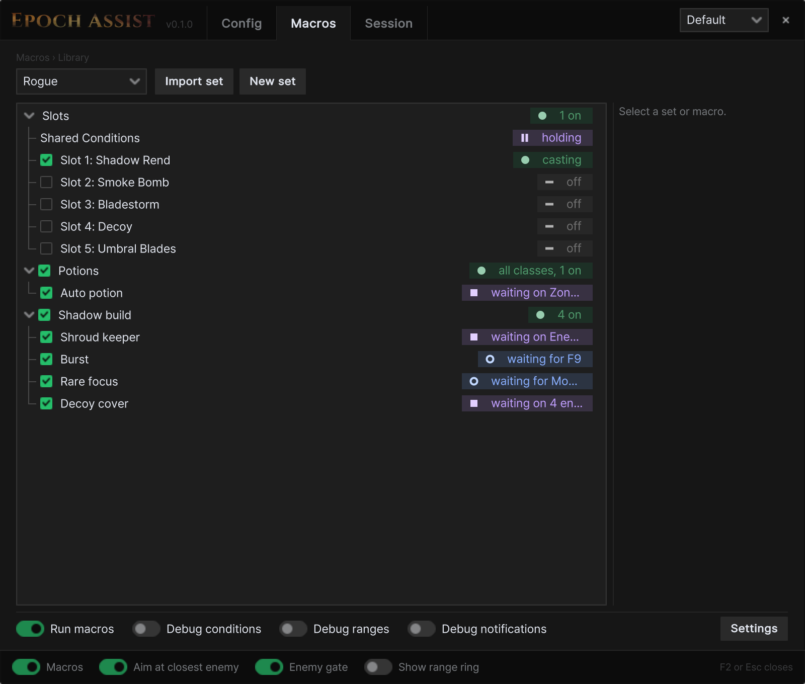
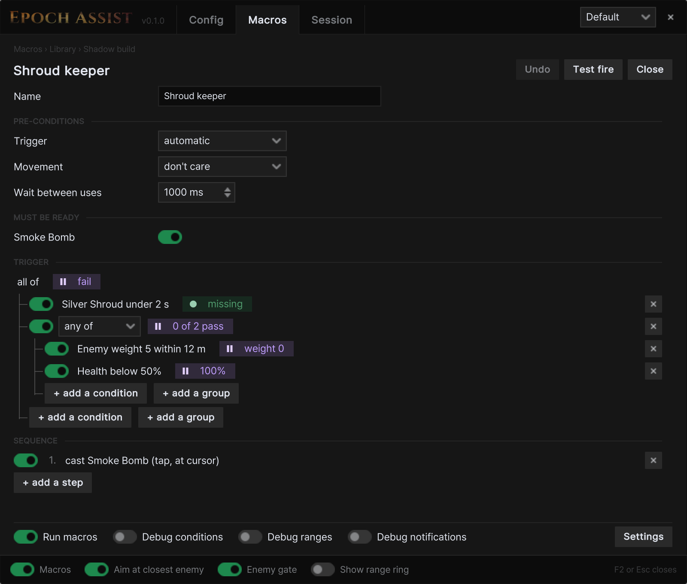
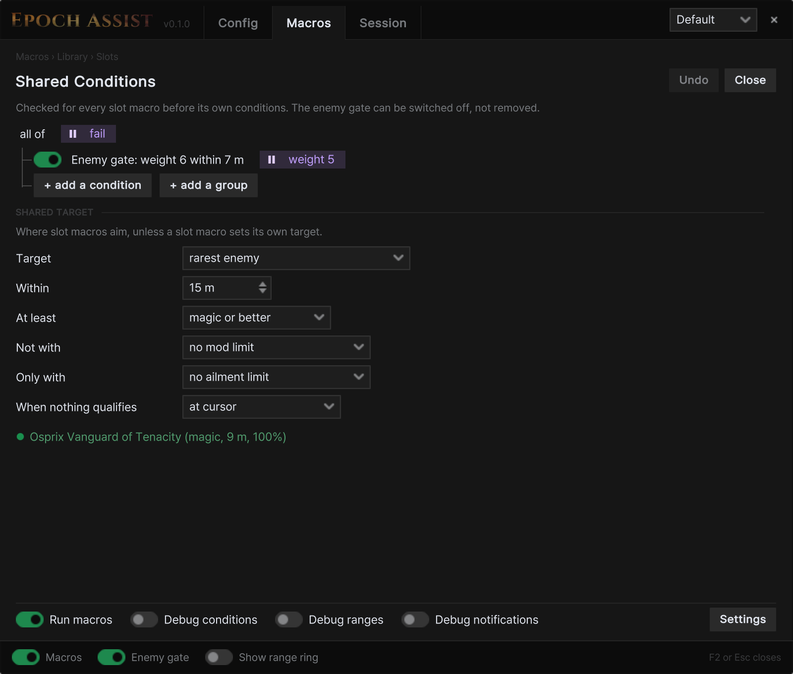
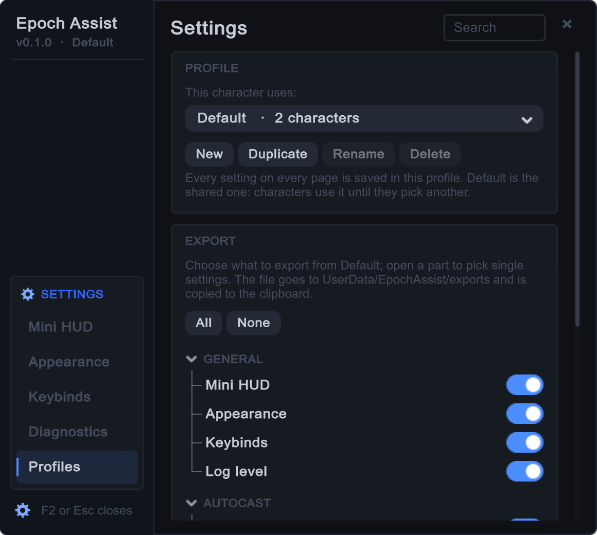
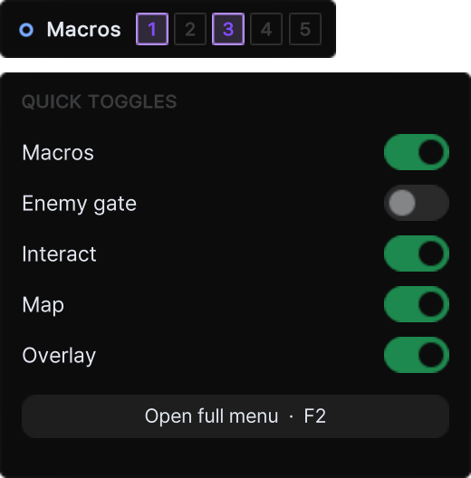
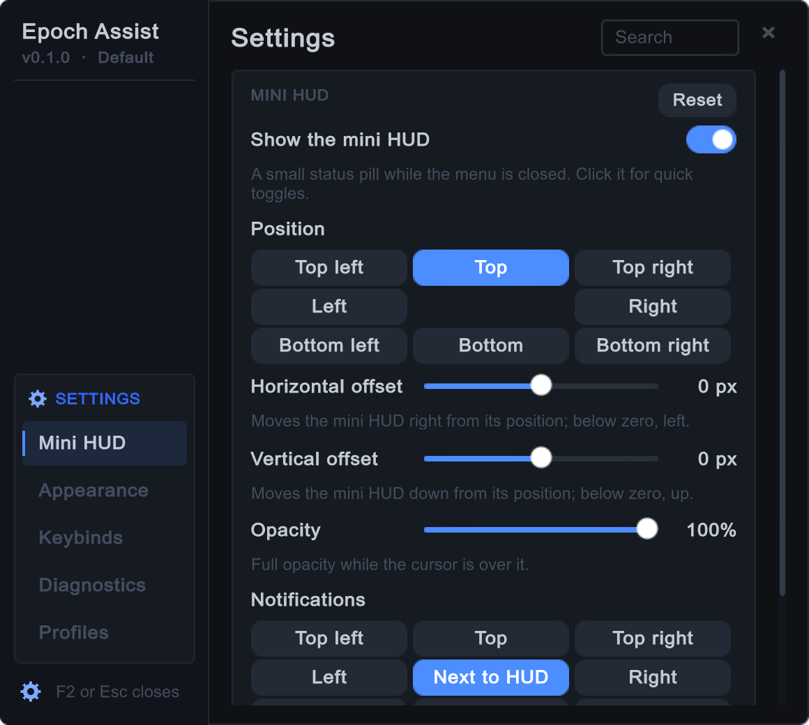
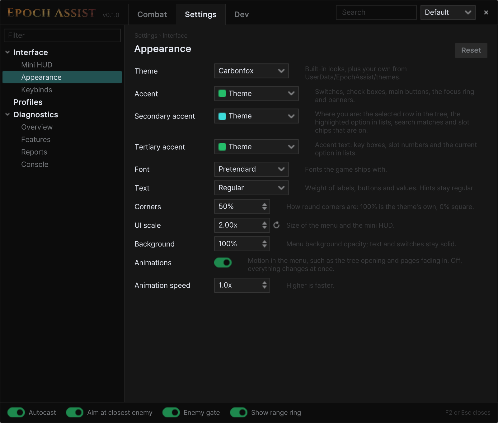
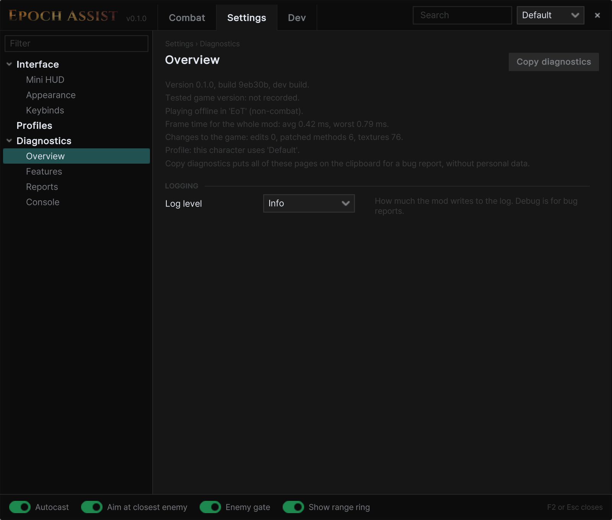

# Epoch Assist

A [MelonLoader](https://github.com/LavaGang/MelonLoader) mod suite for Last Epoch.

> Using mods online is against Last Epoch's terms of service.

## Install

1. Install the [latest MelonLoader](https://github.com/LavaGang/MelonLoader/releases/latest) into the game folder and
   start the game once.
2. Extract the [release](https://github.com/wistb/EpochAssist/releases) zip into your Last Epoch folder (where
   `Last Epoch.exe` is).
3. In game, press **F2** to open the menu.

## Features

- **Macros**: everything automated lives on the Macros tab.
  - **Skill Slots**: **Left Ctrl** + a skill's key turns that slot on or off. Each slot has its own conditions, and
    **Shared Conditions** (such as the enemy gate) apply to all of them.
  - **Macros**: sorted into sets per class, or for all classes. Each starts on its own, on a key press, while a key
    is held, or on a toggle, then runs its steps: cast a skill, drink a potion, open a town portal, wait, wait until,
    or show a message.
  - **Targets**: casts aim at the cursor, the nearest, rarest or weakest enemy, or the middle of a pack, with
    limits by range, rarity, mod and ailment.
  - **Conditions**: health, mana, ward, buffs, skills, potions, enemies (nearest, under the cursor, a target or the
    cast target: their health, rarity, mods and ailments), zone and more, grouped as all of, any of or none of, and
    optionally held for a time.
  - **Sharing**: **Copy share code** puts a set on the clipboard; **Import set** adds one, switched off.
  - **Potions**: a ready-made Auto potion drinks when a whole potion's heal is missing or health is low. It comes
    switched off.
  - **Debugging**: the footer switches show each macro's state, the enemy ranges and targets in use, and a
    notification naming the line that started each macro and what it aims at.
  <details><summary>Screenshots</summary>

  

  

  

  </details>
- **Proximity Interact** (Configuration tab): uses what you walk up to, from where you stand, one thing at a time.
  It activates shrines, opens chests, caches and echo reward chests, starts rune prisons, forges, unstable rifts and
  blood crystals, and picks up keys, crafting materials (affix shards, runes, glyphs) and the items your loot filter
  shows. It never walks your character to anything and never reaches farther than the game itself allows; items your
  loot filter hides are never picked up.
  Every kind starts switched off. Optional: a hold key to pause it or to use things only while held, a count on the
  mini HUD (choose which kinds it counts), a notification for each use, and rings showing the reach.
- **Session**: the Session tab shows this session's XP and gold per hour, drops by rarity, the drops your loot
  filter shows, deaths and echoes, and your past sessions. They are kept in `UserData/EpochAssist/sessions/` within
  limits you set; **Export CSV** writes them as two spreadsheet files. Switch it off under History.

## Settings

Open the Config tab at the top of the menu. The search box above the tree on the left finds any setting.

- **Profiles**: one setup per character. Export and import to share.
  <details><summary>Screenshot</summary>

  

  </details>
- **Mini HUD**: shows the macros' state and slots while the menu is closed. Click it for quick toggles. Its
  notifications have their own position, duration, how many show at once, which kinds and order.
  <details><summary>Screenshots</summary>

  

  

  </details>
- **Appearance**: themes (Carbonfox, Slate, Ember, Epoch, Glass), fonts and animations. **Colour vision** picks
  rarity and danger colours that stay apart for deuteranopia, protanopia or tritanopia in the mod's own overlays.
  <details><summary>Screenshot</summary>

  

  </details>
- **Diagnostics**: **Copy diagnostics** puts the mod's state on the clipboard for a bug report, without names or folder
  paths. **Mods** lists the other mods loaded and where they patch the same game code. Nothing is sent anywhere.
  <details><summary>Screenshot</summary>

  

  </details>

The mod saves everything in `UserData/EpochAssist/` in the game folder.

## Menu controls

| Key | Does |
|---|---|
| Tab / Up / Down | move between controls |
| Enter / Space | press, toggle or pick |
| Left / Right | adjust a slider or option |
| PageUp / PageDown | switch page |
| Esc | close the menu |

## Bug reports

Config → General → Diagnostics → **Copy diagnostics**, then paste it into an [issue](https://github.com/wistb/EpochAssist/issues).
Crash reports are in `UserData/EpochAssist/reports/`.

## Building from source

Create `build.local.env` next to `build.sh`:

```sh
LE_ML='C:\path\to\Last Epoch\MelonLoader'
NUGET_SOURCE='https://api.nuget.org/v3/index.json'
```

Then run `./build.sh` (debug build), `./build.sh deploy` (build and copy to `Mods/`) or `./build.sh release` (zip in `dist/`).

`./build.sh deploy-release` installs the release build in `Mods/`, `./build.sh status` shows which build is installed,
and `./build.sh dev` switches back.

## License

GPL-3.0 (see [LICENSE](LICENSE)).
