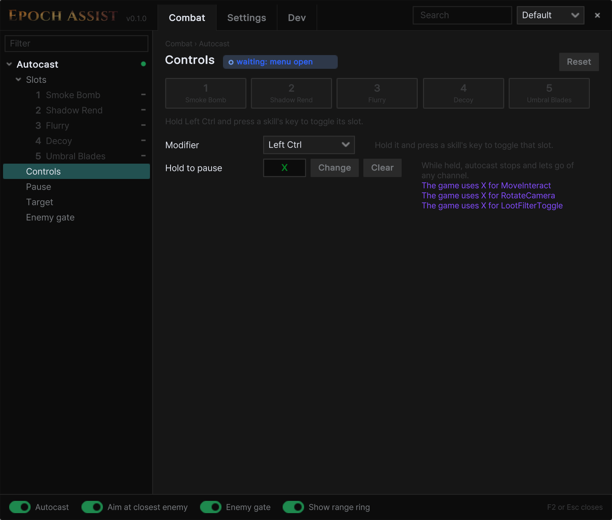
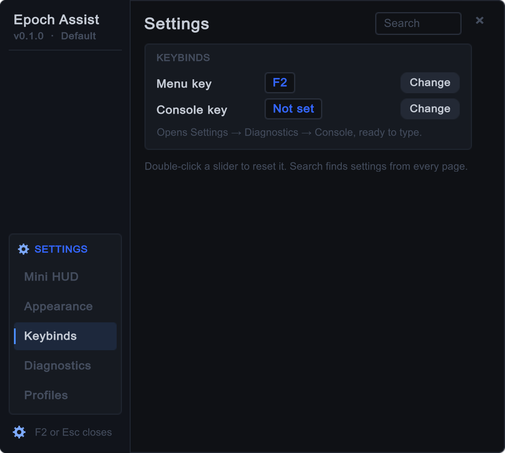

# Epoch Assist

A [MelonLoader](https://github.com/LavaGang/MelonLoader) mod suite for Last Epoch.

> Using mods online is against Last Epoch's terms of service.

## Install

1. Install MelonLoader 0.7.x into the game folder and start the game once.
2. Extract the [release](https://github.com/wistb/EpochAssist/releases) zip into your Last Epoch folder (where
   `Last Epoch.exe` is).
3. In game, press **F2** to open the menu.

## Features

- **Autocast**: **Left Ctrl** + a skill's key turns autocast on or off for that slot. Optional: enemy gate, aim at the
  closest enemy, hold-to-pause key.
  <details><summary>Screenshot</summary>

  

  </details>

## Settings

Open Settings with the gear in the menu's sidebar.

- **Mini HUD**: shows autocast's state and slots while the menu is closed. Click it for quick toggles.
  <details><summary>Screenshots</summary>

  

  

  </details>
- **Appearance**: themes (Slate, Ember, Epoch, Glass), fonts and animations.
  <details><summary>Screenshot</summary>

  

  </details>
- **Keybinds**: change any key.
  <details><summary>Screenshot</summary>

  

  </details>
- **Diagnostics**: **Copy diagnostics** puts the mod's state on the clipboard for a bug report, without names or folder
  paths. Nothing is sent anywhere.
  <details><summary>Screenshot</summary>

  

  </details>
- **Profiles**: one setup per character. Export and import to share.
  <details><summary>Screenshot</summary>

  

  </details>

The mod saves everything in `UserData/EpochAssist/` in the game folder.

## Menu controls

| Key | Does |
|---|---|
| Tab / Up / Down | move between controls |
| Enter / Space | press, toggle or pick |
| Left / Right | adjust a slider or option |
| PageUp / PageDown | switch page |
| Esc | close the menu |

## Bug reports

Settings → Diagnostics → **Copy diagnostics**, then paste it into an [issue](https://github.com/wistb/EpochAssist/issues).
Crash reports are in `UserData/EpochAssist/reports/`.

## Building from source

Create `build.local.env` next to `build.sh`:

```sh
LE_ML='C:\path\to\Last Epoch\MelonLoader'
NUGET_SOURCE='https://api.nuget.org/v3/index.json'
```

Then run `./build.sh` (debug build), `./build.sh deploy` (build and copy to `Mods/`) or `./build.sh release` (zip in `dist/`).

`./build.sh deploy-release` installs the release build in `Mods/`, `./build.sh status` shows which build is installed,
and `./build.sh dev` switches back.

## License

MIT
